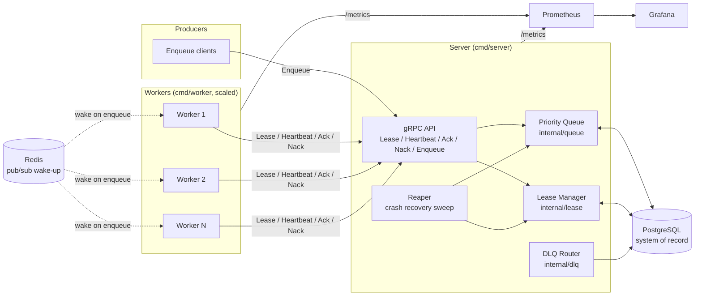
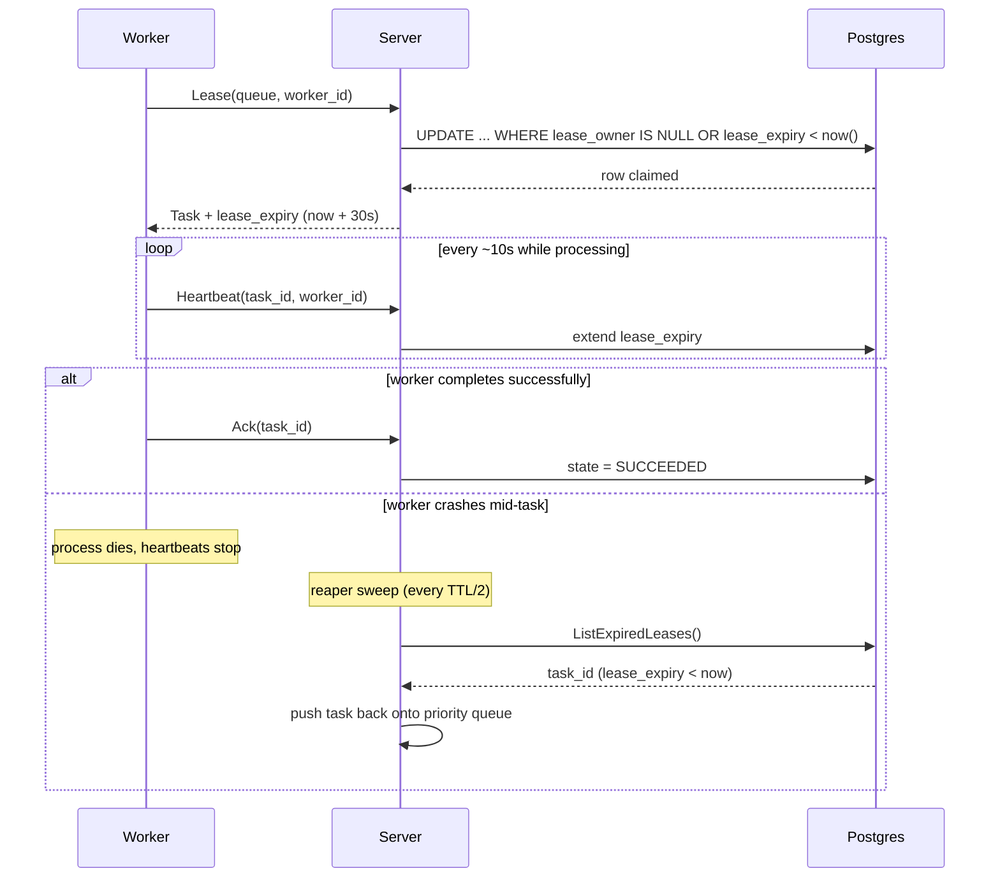

# Distributed Task Queue

A distributed task queue written in Go, built around at-least-once
delivery, priority scheduling, and automatic crash recovery via a
heartbeat/lease protocol over gRPC. Instrumented with Prometheus and
Grafana, containerized with Docker Compose.

## Features

- **At-least-once delivery** via Postgres-backed compare-and-swap state
  transitions — a task is never marked taken unless the lease grant
  actually commits.
- **Priority scheduling** with a binary-heap scheduler (`internal/queue`)
  ordered by priority then age, so backoff-delayed retries don't starve
  newer same-priority work.
- **Configurable retries** with full-jitter exponential backoff
  (`internal/retry`) to avoid thundering-herd retries against a struggling
  downstream.
- **Dead-letter queues** for tasks that exhaust their retry budget, with
  full failure history preserved for inspection/replay (`internal/dlq`).
- **Worker coordination via heartbeat/lease over gRPC**
  (`api/proto/taskqueue/v1/taskqueue.proto`, `internal/lease`) — a crashed
  worker's lease simply expires and a background reaper reclaims the task,
  giving automatic crash recovery without a separate failure detector.
- **Observability**: Prometheus metrics for queue depth, task latency
  (p50/p95/p99 via histogram), worker health, lease reclamation rate, and
  dead-letter rate, visualized in a provisioned Grafana dashboard.
- **Docker Compose** stack: server, worker (scaled), Postgres, Redis,
  Prometheus, Grafana — one command to bring the whole system up.

## Architecture



### Lease lifecycle and crash recovery



See [`docs/architecture.md`](docs/architecture.md) for the full design
rationale, including why Postgres is the system of record while Redis is
only a wake-up fast path, and the retry/backoff and dead-letter design.

## Project layout

```
.
├── api/proto/taskqueue/v1/   # gRPC service + message definitions
├── cmd/
│   ├── server/                # coordinator: scheduling, leasing, reaping
│   └── worker/                # leases tasks, executes, acks/nacks
├── internal/
│   ├── model/                  # Task domain type
│   ├── queue/                  # priority-heap scheduler
│   ├── retry/                  # exponential backoff with full jitter
│   ├── lease/                  # heartbeat/lease manager
│   ├── dlq/                    # dead-letter routing
│   ├── storage/                # Postgres (durable) + Redis (notify) stores
│   ├── metrics/                # Prometheus collectors
│   └── config/                 # YAML + env config loading
├── migrations/                 # Postgres schema
├── configs/                    # server.yaml / worker.yaml
├── deployments/                # Dockerfiles, docker-compose, Prometheus, Grafana
├── docs/                       # architecture notes
└── .github/workflows/          # CI: vet, fmt check, test, docker build
```

## Running locally

```bash
make up        # builds images and starts server, workers, postgres, redis, prometheus, grafana
make logs       # tail logs
make down       # tear down and remove volumes
```

Once up:

| Service    | Address                         |
|------------|----------------------------------|
| gRPC API   | `localhost:50051`                |
| Prometheus | http://localhost:9099            |
| Grafana    | http://localhost:3000 (anonymous viewer access) |

The Grafana dashboard (`deployments/grafana/dashboards/queue-overview.json`)
is auto-provisioned and includes queue depth, latency percentiles,
throughput, worker health, lease reclamation, and dead-letter rate panels,
built directly from the Prometheus metrics defined in
`internal/metrics/metrics.go`.

## Testing

```bash
make test     # go test ./... -race -cover
```

Unit tests cover the priority scheduler, backoff policy, and lease manager
(including concurrent-acquire rejection, expiry-based reclamation, and
renewal), since those are the components where correctness actually
matters most for the delivery guarantees above.

## Implementation status

The core logic — priority scheduling, retry/backoff, lease coordination
and crash recovery, dead-letter routing, and the Postgres/Redis storage
layer — is fully implemented and unit-tested.

The gRPC transport wiring (`cmd/server`, `cmd/worker`) is structured
against the service defined in
[`api/proto/taskqueue/v1/taskqueue.proto`](api/proto/taskqueue/v1/taskqueue.proto),
but the generated stubs aren't checked into the repo — run `make proto`
(requires `protoc` + the Go plugins) to generate them, after which the
`TODO`-marked call sites plug directly into the existing
`internal/lease`, `internal/retry`, and `internal/storage` types. See
[`docs/architecture.md`](docs/architecture.md#whats-implemented-vs-stubbed)
for details.

## License

[MIT](LICENSE)
